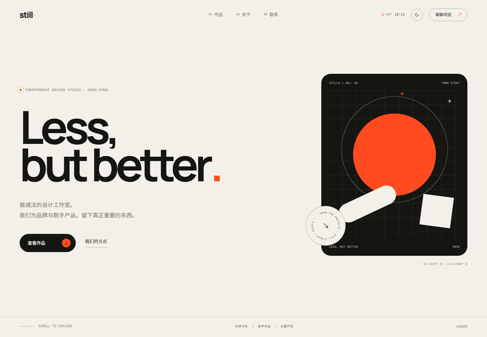

# STILL® — Less, but better.

一个可以直接托管在 GitHub Pages 上的极简扁平风格单页网站。纯 HTML / CSS / JavaScript，无框架、无构建步骤、无 npm 依赖。



## 页面内容

- **首屏**：超大标题、扁平几何主视觉、旋转徽章、实时香港时间
- **作品**：四个项目，悬停时显示跟随鼠标的视觉预览
- **关于**：工作室宣言、服务清单与滚动数字统计
- **联系**：深色收尾、邮件入口与页脚
- **细节**：深浅主题、移动端全屏菜单、无刷新锚点导航

## 动画与交互

- 首次访问的进度条加载动画
- 标题逐行上滑、首屏元素错峰淡入
- 滚动进入视口时的文字遮罩显现
- 数字递增动画
- 作品行悬停反色 + 跟随鼠标的动态预览卡
- 磁吸按钮、自定义光标
- 无限滚动跑马灯、旋转圆形文字
- 深色 / 浅色主题切换（记忆偏好）
- 移动端菜单滑入与链接逐项出现

所有主要动画均使用 `transform` / `opacity`，并完整适配 `prefers-reduced-motion`。触屏设备会自动关闭悬停预览与自定义光标；JavaScript 不可用时，正文内容仍然可见。

## 文件说明

```text
still-site/
├── index.html      页面结构与文案
├── styles.css      全部样式、响应式与动画
├── script.js       加载、主题、滚动、菜单、悬停预览等交互
├── favicon.svg     站点图标
├── preview.png     README 预览图（可按需删除）
├── .nojekyll       让 GitHub Pages 跳过 Jekyll 处理
└── README.md
```

## 本地预览

直接双击 `index.html` 即可。

更接近真实托管的预览方式：

```bash
cd still-site
python -m http.server 8000
```

然后打开 <http://localhost:8000>。

> 页面首次打开会播放约 2 秒的加载动画，并在当前标签页记住已访问状态。想反复查看加载动画，请使用无痕窗口，或清除该站点的 session storage。

## 部署到 GitHub Pages

### 方式一：网页上传（最简单）

1. 新建一个 GitHub 仓库。
2. 把 `still-site` 目录**里面的内容**上传到仓库根目录，不要上传整个文件夹。
3. 打开仓库的 **Settings → Pages**。
4. 在 **Build and deployment** 中选择 **Deploy from a branch**。
5. Branch 选 `main`，目录选 `/ (root)`，保存。
6. 等待几十秒后访问：
   - 项目仓库：`https://<用户名>.github.io/<仓库名>/`
   - 用户主页仓库（仓库名为 `<用户名>.github.io`）：`https://<用户名>.github.io/`

如果通过 Git 上传，`.nojekyll` 会自动保留；如果通过网页拖拽上传，请确认它没有被忽略。

### 方式二：Git 命令

```bash
cd still-site
git init
git add .
git commit -m "Initial site"
git branch -M main
git remote add origin https://github.com/<用户名>/<仓库名>.git
git push -u origin main
```

然后按上面的网页步骤启用 Pages。

## 自定义

### 1. 替换文案与项目

编辑 `index.html`：

- 修改 `<title>`、`meta[name="description"]` 和 Open Graph 文案
- 搜索 `hello@still.studio`，换成你的邮箱
- 搜索 `https://github.com`、`https://www.instagram.com`、`https://www.are.na`，换成你的主页
- 修改 4 个 `.project` 与对应的 `.preview-card`
- 修改关于、服务与页脚信息

示例品牌、项目、数据、邮箱与社交链接都是占位内容，上线前请替换。

### 2. 调整配色

在 `styles.css` 顶部修改：

```css
:root {
  --paper: #f3f0e9;   /* 页面底色 */
  --ink: #151512;     /* 主文字 / 深色块 */
  --muted: #736f66;   /* 次要文字 */
  --accent: #ff4b1f;  /* 强调色 */
}

html[data-theme="dark"] {
  --paper: #121210;
  --ink: #f1eee5;
  --accent: #ff5a30;
}
```

联系区固定使用深色背景，可调整 `--contact-bg`、`--contact-fg`。

### 3. 更换字体

`index.html` 中引入了 Google Fonts 的 Manrope、Noto Sans SC 与 DM Mono。如果不需要外部请求，删除对应的 `<link>`，再在 `styles.css` 的 `--font-sans` / `--font-mono` 中使用系统字体即可。

### 4. 调整动画

- 关闭某类动效：删除 `script.js` 中对应初始化块，或在 `styles.css` 中删除相关规则
- 修改速度：主要缓动变量为 `--ease`，动画时长可在各 `transition` / 关键帧中调整
- 已遵守 `prefers-reduced-motion: reduce`：当访客在系统中关闭动画时，页面会自动呈现静态版本

### 5. 社交分享图

如需在分享链接时显示图片，可在部署后给 `index.html` 增加一条绝对地址：

```html
<meta property="og:image" content="https://<你的域名>/preview.png">
```

## 浏览器支持

面向现代浏览器（Chrome、Edge、Safari、Firefox 近两年版本）。核心内容不依赖新特性；`view-transition` 等增强效果不支持时会自动回退。没有构建工具，任何静态托管平台都可以使用。

---

设计与代码均可自由修改，用于个人或商业项目。
